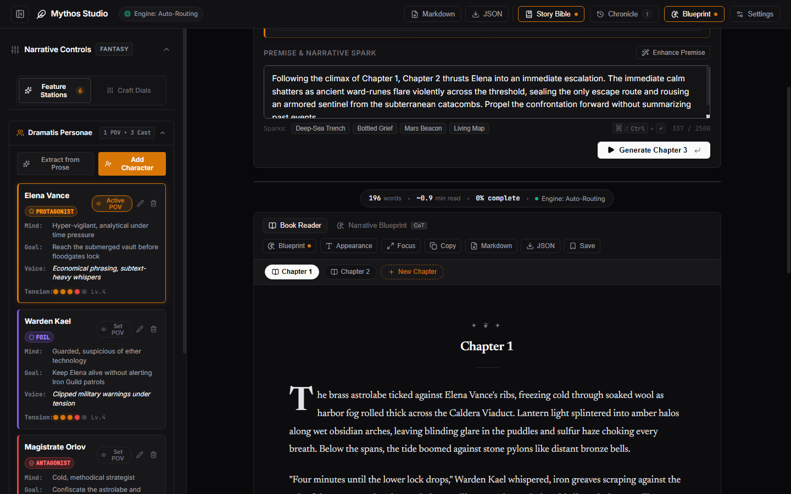
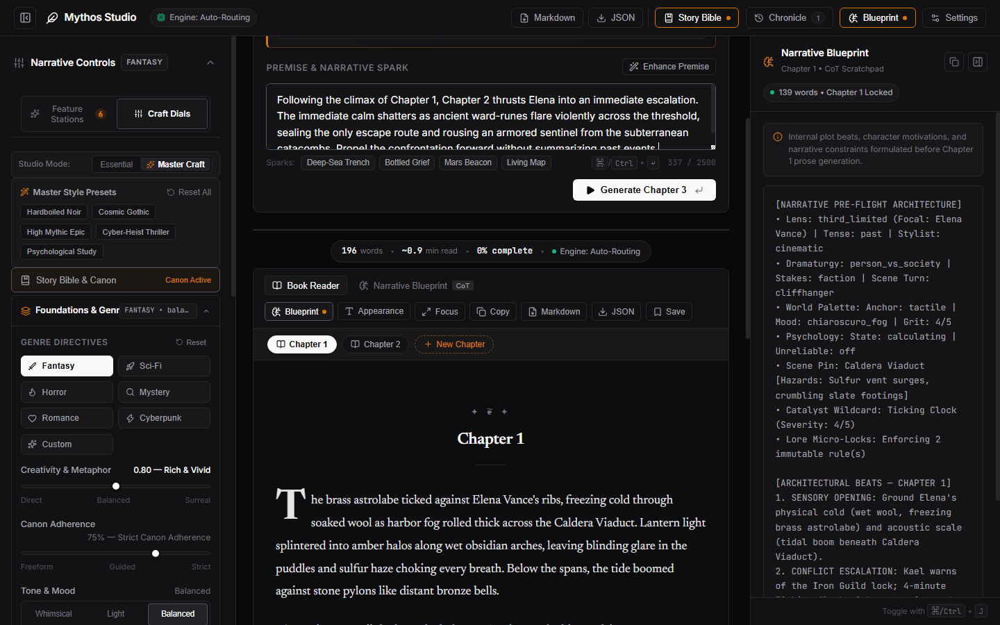
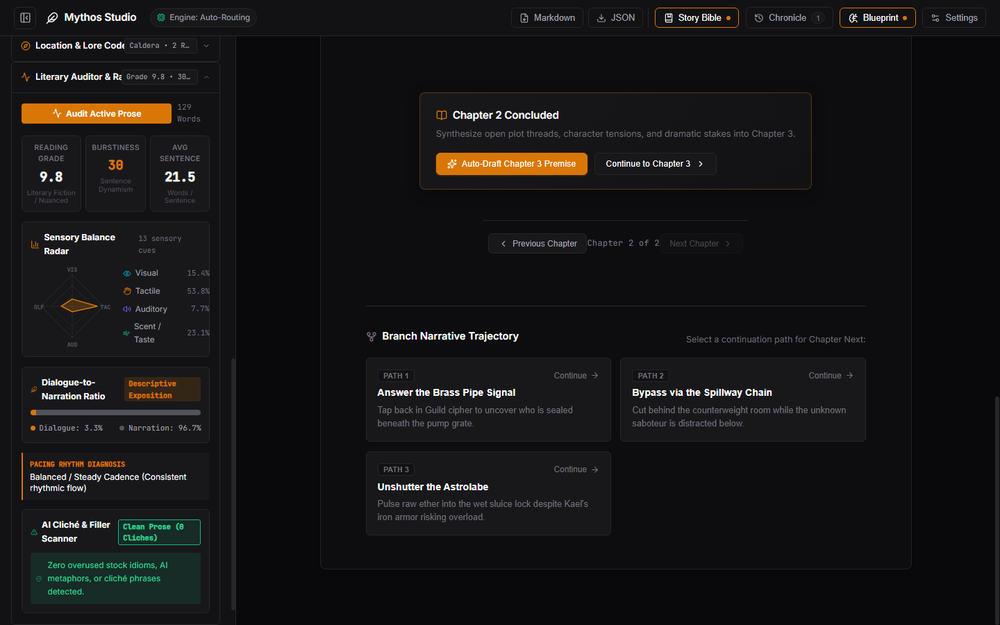
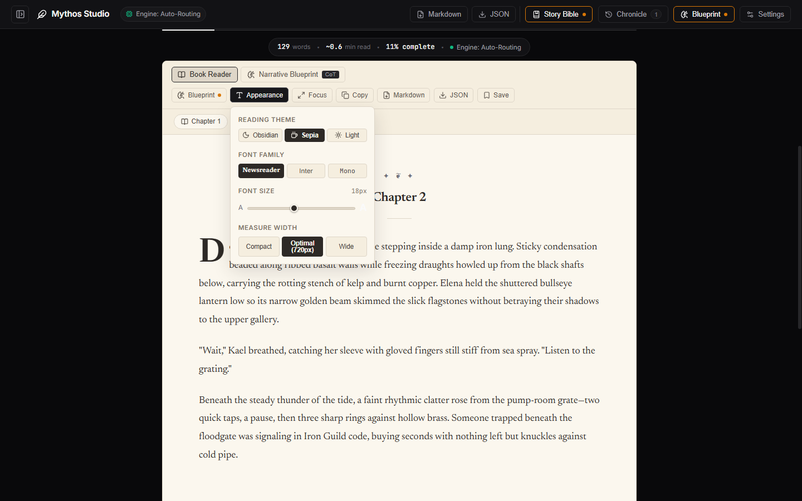
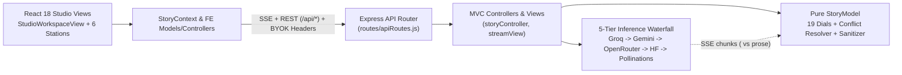

# Mythos Studio — AI Story Generator & Multi-Chapter Saga Suite

> **Project Started:** January 27, 2026  
> **Architecture:** Full-Stack MVC (React 18 + Vite Frontend | Node.js + Express Backend)  
> **Inference:** 5-Tier Zero-Cost Streaming Waterfall with Optional BYOK  
> **Verification:** `215` Automated Tests (`16` Suites, `0` Skipped) + Vite Production Build + GitHub Actions CI ([`.github/workflows/ci.yml`](.github/workflows/ci.yml))

**Mythos Studio** is an editorial AI fiction workstation that turns short story sparks into multi-chapter sagas using tunable narrative craft dials, real-time Server-Sent Event (SSE) token streaming, Chain-of-Thought blueprint isolation, procedural plot catalysts, scene illustration, synchronized voice & procedural ambient audio theater, and algorithmic prose diagnostics.

---

## Engineering Snapshot & Reviewer Navigation

To keep this README crisp and scannable while surfacing complete implementation depth, architectural specifications and test inventories live in modular [`docs/`](docs/) guides:

| What to Explore | Key Technical Scope | Guide |
|---|---|---|
| **Full-Stack MVC Architecture** | Express & React MVC boundaries, SSE streaming sequence (`sanitizeStreamBuffer`), `<1800ms` continuation SLA, 12 REST/SSE endpoints | [Architecture & API Flows](docs/ARCHITECTURE.md) |
| **Core Engineering Highlights** | Problem → Solution → Trade-offs across waterfall failover, conflict resolution, 6 Studio Stations, `.env`/SVG security, Vite chunks | [Engineering Highlights](docs/ENGINEERING_HIGHLIGHTS.md) |
| **Quality & Adversarial Testing** | 5-tier methodology covering all `16` test files (`93` backend + `73` frontend + `49` E2E/Tier-5 stress tests = `215` passing) | [Testing & Quality Report](docs/TESTING_AND_QUALITY.md) |
| **Continuous Integration** | Automated `npm --prefix backend ci`, `npm --prefix frontend ci`, and `npm run verify:full` matrix (`Node 20.x` & `22.x`) | [CI Workflow](.github/workflows/ci.yml) |

---

## Studio UI Showcase

Captured directly from the live React 18 Studio UI with deterministic saga & audit state:

| Main 3-Pane Workspace & Cast POV | Master Craft Dials & CoT Blueprint |
|---|---|
|  |  |
| **Studio Workspace**: Active POV Dramatis Personae cards, Premise & Narrative Spark controls, Telemetry HUD, and Drop-Cap Chapter Reader. | **Craft Dials & Blueprint**: Master Style Presets + 19 craft dials synchronized with the live `[NARRATIVE PRE-FLIGHT ARCHITECTURE]` CoT scratchpad. |

| Literary Auditor Radar & Saga Trajectory | Warm Sepia Reader & Typography Controls |
|---|---|
|  |  |
| **Prose Diagnostics & Saga Controls**: 4-pole SVG sensory radar (`298` lexical cues), cliché scanner (`35` patterns), Guided CTA card, pagination, and branch cards. | **Editorial Reader**: Obsidian / Sepia / Light themes, Newsreader / Inter / Mono fonts, adjustable text scale & measure (`600` / `720` / `860px`). |

---

## Project Genesis & AI-Driven Evolution

### Origins — Baseline v1.0 (Started January 27, 2026)

Development started on **January 27, 2026** as a minimal single-shot proof-of-concept:
- **Single-Provider Lock-In**: `huggingface.js` relied solely on `@huggingface/inference` (`mistralai/Mixtral-8x7B-Instruct-v0.1`) and failed immediately without `HUGGINGFACE_API_KEY`.
- **Blocking Request Flow**: One synchronous `POST /api/generate` endpoint—no token streaming, no `AbortController`, and no rate-limit failover.
- **Static Prompt Template**: A 43-line `promptEngineering.js` wrapper injected one fixed prompt without POV, tense, pacing, psychology, or continuity memory controls.
- **3-Component UI**: A basic textarea, loading indicator, and plain output card with a copy button and zero test coverage.

### Evolution to Mythos Studio v3.0 MVC

Through iterative AI-assisted system design, full-stack MVC refactoring, and adversarial test hardening, the codebase evolved across every layer:

| Engineering Dimension | Initial Baseline (Jan 27, 2026) | Current Architecture (Mythos Studio v3.0 MVC) |
|---|---|---|
| **Architecture Pattern** | Single route handler & monolithic React component | Explicit **MVC separation** (`models/`, `views/`, `controllers/`, `routes/`, `services/`) across backend & frontend |
| **Inference Reliability** | Single Hugging Face model (`Mixtral-8x7B`), key required | **5-tier streaming waterfall**: Groq (`qwen/qwen3.8-27b` → `allam-2-7b`) → Gemini (`gemini-1.5-flash`) → OpenRouter (`llama-3.3-70b-instruct:free`) → HF (`Qwen2.5-72B-Instruct`) → Pollinations zero-auth |
| **Streaming & Sanitization** | Blocking JSON response | Real-time **SSE streaming** (`12s` heartbeats, `AbortController`), `<thinking>` / `[STORY_START]` / `[STORY_END]` isolation, preamble stripping |
| **Narrative Control Engine** | 1 static system prompt (43 lines) | **19 Craft Dials** across 5 accordions, 5 Master Presets, 7 Genres, `resolveConflicts` harmonizer & CoT pre-flight checklist |
| **Saga Continuity** | Single-shot standalone text | Per-chapter immutable model (`{ number, title, content, thinking, timestamp }`), Story Bible lock, `<1800ms` continuation API + `<2ms` heuristic fallback |
| **Creative Studio Stations** | None | **6 Feature Stations**: Dramatis Personae, Plot Catalyst Dice, Scene Illustrator, Audio Theater, Location & Lore Codex, Literary Auditor |
| **Quality Verification** | 0 automated tests | **`215` passing automated tests** across 16 suites (Unit, MVC Contract, E2E Saga & Tier-5 Concurrency/Stress) + Vite chunk check |

---

## System Architecture & Streaming Flow



<details>
<summary><strong>MVC Directory Layout (Click to expand backend/ and frontend/ structure)</strong></summary>

```text
ai-story-generator/
├── .github/workflows/ci.yml                   # Node 20.x & 22.x build + verify:full pipeline
├── docs/                                      # Technical architecture, highlights, testing & UI screenshots
├── package.json                               # Root orchestrator scripts (start, dev, build, test, verify:full)
├── backend/
│   ├── app.js & server.js                     # Express composition root & server bootstrapper
│   ├── routes/apiRoutes.js                    # Declarative REST & SSE route registry (12 endpoints + alias)
│   ├── controllers/                           # Request validation & orchestration (5 domain controllers)
│   ├── models/                                # Pure domain rules (storyModel, settingsModel, imageModel, proseAuditModel)
│   ├── views/streamView.js                    # SSE initialization, 12s heartbeats & JSON response presenters
│   ├── services/                              # Inference waterfall router, prompt compiler, image & cast services
│   ├── lib/                                   # Backward-compatible export facades
│   └── tests/                                 # 8 backend test suites (93 tests)
├── frontend/src/
│   ├── App.jsx & views/StudioWorkspaceView.jsx # Root Studio container & 3-pane responsive workspace
│   ├── models/                                # Pure state schemas, stationReducer & client stream sanitizer
│   ├── controllers/                           # REST/SSE transport, Scene Illustrator media & Web Speech/Audio control
│   ├── context/StoryContext.jsx               # React state bridge uniting Models & Controllers
│   ├── components/                            # Editorial UI views & 6 modular Feature Stations
│   └── utils/                                 # Procedural dice, sensory auditor, cast extractor, Web Audio synth
└── tests/                                     # Root E2E Saga & Tier-5 Adversarial Stress suites (49 tests)
```

</details>

- Full dependency boundaries, sequence diagrams, and REST/SSE request/response schemas are documented in **[Architecture & API Flows](docs/ARCHITECTURE.md)**.

---

## Core Capabilities

- **Zero-Auth Out-of-the-Box Inference + BYOK Waterfall**: Runs immediately with zero API keys via Pollinations, or routes sequentially across BYOK (`x-byok-*`) and `.env` tiers (`Groq` with automatic `429` OTPM failover from `qwen/qwen3.8-27b` → `allam-2-7b`, `Gemini`, `OpenRouter`, `Hugging Face`) with CR/LF `.env` injection defense ([Highlights §1 & §5](docs/ENGINEERING_HIGHLIGHTS.md)).
- **19-Dial Narrative Craft Engine**: Configurable genre/style presets, POV, tense, dialogue density, authorial voice stylist, conflict/stakes/turn geometry, sensory anchors, visceral realism (`1–5`), protagonist psychology, and automatic cross-dial conflict harmonization ([Highlights §2](docs/ENGINEERING_HIGHLIGHTS.md#2-19-dial-narrative-craft-compiler--cross-constraint-conflict-harmonizer)).
- **6 Integrated Studio Stations**:
  1. *Dramatis Personae* (cast extraction + Focal POV lock injection)
  2. *Plot Catalyst Dice* (6 archetypes × 5 severity levels = `30` procedural complications)
  3. *Scene Illustrator* (`5` art presets, visual prompt extraction, Hugging Face SDXL / Pollinations / XSS-safe SVG fallback)
  4. *Audio Theater* (Web Speech `onboundary` sentence highlighter + procedural Web Audio API soundscapes)
  5. *Location & Lore Codex* (physical environment pins + double-enforced max-2 active Lore Micro-Locks)
  6. *Literary Auditor & Prose Radar* (`298` sensory lexical terms, `35` AI clichés, Flesch-Kincaid Grade/Ease, sentence burstiness)
- **Multi-Chapter Saga Reader**: Isolated per-chapter history & pagination, `<1800ms` continuation premise synthesis (`0.004ms` deterministic heuristic fallback), distraction-free Focus Mode, Chronicle restore, and Markdown/JSON export.

---

## Quick Start

### Prerequisites
- **Node.js 18+** (`node -v`, tested on `20.x` & `22.x`) & **npm**

### Install & Configure (Zero Keys Required)

```bash
cd backend && npm install
cd ../frontend && npm install
cd ..
cp .env.example .env   # Optional: configure GROQ_API_KEY, GEMINI_API_KEY, OPENROUTER_API_KEY, HUGGINGFACE_API_KEY
```

### Run Development Servers

```bash
# Terminal 1 — Backend MVC API (http://localhost:3001)
npm start

# Terminal 2 — Frontend Vite Studio (http://localhost:5173)
npm run dev
```

---

## Verification & Testing

Run the full CI verification pipeline (production Vite bundle build + all `215` tests across backend, frontend, and root adversarial suites):

```bash
npm run verify:full
```

Individual suite targets:

```bash
npm run build           # Vite production bundle -> frontend/dist/
npm run test:backend    # 93 backend unit, SLA, isolation & MVC tests
npm run test:frontend   # 73 frontend model, reducer & station tests
npm run test:e2e        # 49 root E2E saga & Tier-5 adversarial stress tests
```

See **[Testing & Quality Report](docs/TESTING_AND_QUALITY.md)** for the full 5-tier breakdown across all `16` test files.

---

## License

MIT License — see [LICENSE](LICENSE) for full details.
