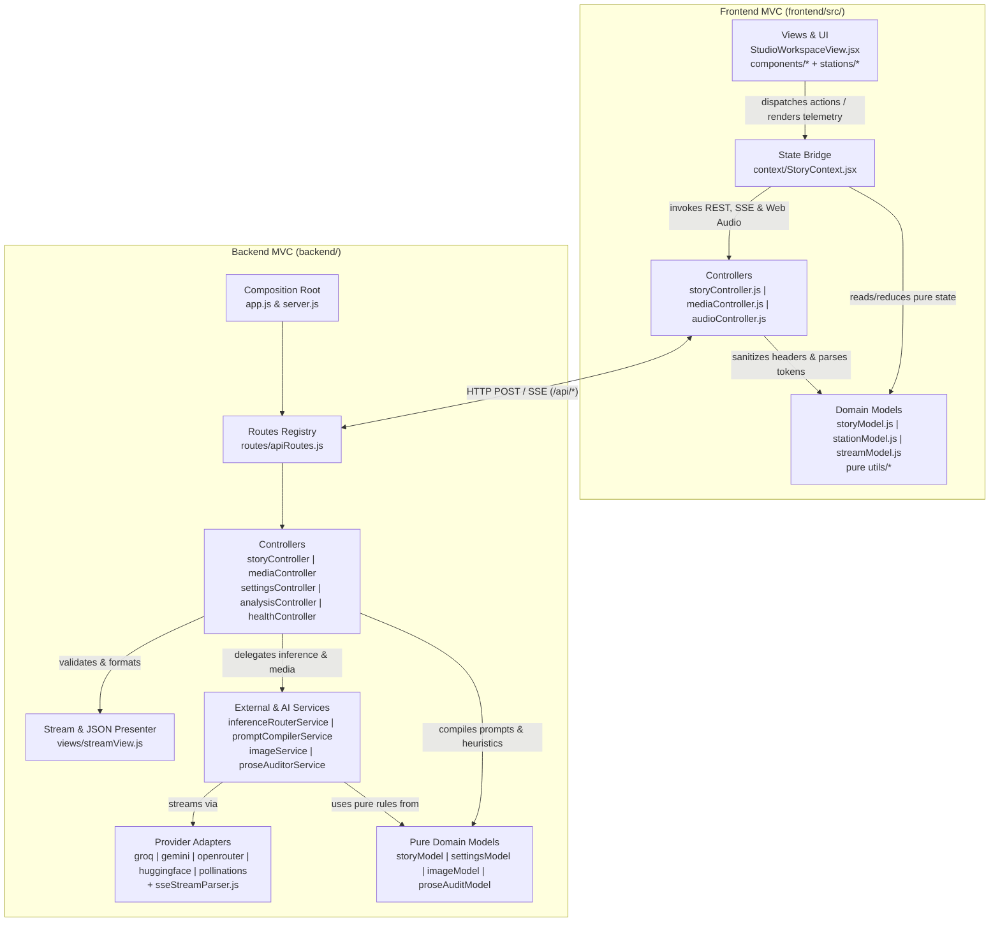

# System Architecture — Mythos Studio (Full-Stack MVC)

This document details the full-stack **Model-View-Controller (MVC)** architecture, Server-Sent Events (SSE) streaming pipeline, multi-chapter state model, and REST API contracts for **Mythos Studio** (`ai-story-generator`).

---

## 1. Full-Stack MVC Topology & Layer Boundaries

Mythos Studio enforces explicit separation of concerns across both `backend/` (Express ESM) and `frontend/src/` (React 18 + Vite). Pure domain models remain free of network or DOM side effects, controllers own orchestration and HTTP/Web API lifecycles, views handle rendering and stream framing, and backward-compatible facades in `backend/lib/` preserve stable import contracts for existing verification suites.



### Layer Responsibilities

| Layer | Backend (`backend/`) | Frontend (`frontend/src/`) |
|---|---|---|
| **Model** (Pure Logic, 0 I/O) | `models/storyModel.js` (craft directives, conflict resolution, SSE sanitizer, continuation hooks), `models/settingsModel.js` (CR/LF sanitization, `.env` diffing, BYOK header extraction), `models/imageModel.js` (art presets, XSS-safe SVG fallback), `models/proseAuditModel.js` (sensory lexicons, clichés, readability, cast heuristics) | `models/storyModel.js` (genre/master presets, chapter normalization, `clampChapterIndex`, Markdown/JSON exporters), `models/stationModel.js` (`stationReducer`, max-2 lore lock enforcement, session import/export), `models/streamModel.js` (client SSE buffer sanitizer, `tokenizeSentences`, BYOK headers), `utils/*` |
| **View** (Formatting & UI) | `views/streamView.js` (`initSseStream`, `12000ms` heartbeat keep-alive, `sendEvent`, `endStream`, `endWithError`, JSON envelope presenters) | `views/StudioWorkspaceView.jsx` (3-pane editorial workbench, hotkeys `Ctrl+B` / `Ctrl+J` / `Esc`), `components/*` (`NarrativeControlPanel`, `PromptInput`, `StoryViewer`, `NarrativeBlueprintSidebar`, `HistoryDrawer`, `StoryBibleModal`, `SettingsModal`, `BranchChoices`), `components/stations/*` (6 stations) |
| **Controller** (Orchestration) | `controllers/storyController.js`, `controllers/mediaController.js`, `controllers/settingsController.js`, `controllers/analysisController.js`, `controllers/healthController.js` | `controllers/storyController.js` (`streamStoryGeneration`, `requestNextChapterPrompt`, `enhancePremiseRequest`, file downloads), `controllers/mediaController.js`, `controllers/audioController.js` (Web Speech + `AmbientAudioController`) |
| **Routes / Bridge / Services** | `routes/apiRoutes.js`, `app.js`, `server.js`, `services/*`, `services/providers/*`, `lib/*` (compatibility facades) | `App.jsx`, `context/StoryContext.jsx` (unified state provider & chapter lifecycle coordinator) |

---

## 2. Real-Time SSE Generation & Inference Failover Flow

When the user initiates a chapter stream, `POST /api/generate/stream` compiles all 19 craft dials, Story Bible locks, active Feature Station pins, and prior chapter summaries into a structured system prompt, opens an SSE transport with `12s` keep-alives and an `AbortController`, and streams tokens through the 5-tier provider waterfall while isolating `<thinking>` reasoning from live story prose.

```mermaid
sequenceDiagram
    autonumber
    actor Author
    participant FE as Frontend StoryContext +<br/>storyController.js
    participant CTRL as Backend<br/>storyController.js
    participant MODEL as storyModel.js<br/>(Compiler & Sanitizer)
    participant VIEW as streamView.js<br/>(SSE Presenter)
    participant ROUTER as inferenceRouterService.js<br/>(5-Tier Waterfall)

    Author->>FE: Trigger Generate Chapter (seed + dials + 6 station pins)
    FE->>CTRL: POST /api/generate/stream (JSON body + x-byok-* headers)
    CTRL->>VIEW: initSseStream(res, abortController)
    VIEW-->>FE: HTTP 200 text/event-stream + 12s ": keep-alive" heartbeats

    CTRL->>MODEL: compileNarrativePayload(...)
    MODEL-->>CTRL: { systemPrompt, userMessage, parameters, meta }
    CTRL->>VIEW: sendEvent("start", { meta, parameters })

    CTRL->>ROUTER: routeStoryStream({ systemPrompt, userMessage, byok, signal })
    loop Waterfall Tiers (BYOK -> Env -> Pollinations)
        ROUTER-->>VIEW: sendEvent("provider", { provider, providerId })
        alt Upstream HTTP 429 or outage BEFORE content emitted
            Note over ROUTER: Groq qwen/qwen3.8-27b retries allam-2-7b first;<br/>then switches to next tier (Gemini -> OpenRouter -> HF -> Pollinations)
            ROUTER-->>VIEW: sendEvent("warning", { message })
        else Upstream token chunks arriving
            ROUTER-->>CTRL: chunk { type: "thinking" | "prose", text }
            CTRL->>MODEL: sanitizeStreamBuffer(fullGeneratedProse)
            MODEL-->>CTRL: { thinking, prose } (preamble-stripped, partial tags withheld)
            CTRL->>VIEW: sendEvent("chunk", { type, text: delta })
            VIEW-->>FE: SSE frame -> sanitizeClientStreamBuffer() -> live StoryViewer & Blueprint
        end
    end

    CTRL->>MODEL: parseStoryStreamOutput(combined)
    MODEL-->>CTRL: { prose, thinking, branchChoices }
    CTRL->>VIEW: sendEvent("complete", { prose, thinking, branchChoices, timestamp })
    CTRL->>VIEW: endStream() -> "data: [DONE]"
```

### Disconnect & Partial-Stream Safety
- **Mid-Stream Failover Guard**: In `backend/services/inferenceRouterService.js`, `hasEmittedContent` prevents switching providers once prose or thinking tokens have been streamed to the client, avoiding incoherent mid-sentence model splicing.
- **Socket Teardown**: `streamView.js` binds `res.on('close')` to clear the `12000ms` heartbeat timer and call `abortController.abort()`, immediately canceling upstream `fetch()` requests.
- **Frontend Partial Recovery**: If an active stream is interrupted after partial output arrives, `StoryContext.jsx` commits the sanitized partial chapter state (`partialProse`, `partialThinking`) or restores the prior chapter index (`fallbackIdx`) so existing chapters are never overwritten.

---

## 3. Multi-Chapter Saga State & Paginated Canvas Lifecycle

Each chapter is stored as an isolated immutable record inside `chapters[]` rather than concatenating text into a single scrolling blob:

```js
{
  number: Number,      // 1-based sequence index (1, 2, 3...)
  title: String,       // "Chapter N" or parsed chapter heading
  content: String,     // Pure prose stripped of <thinking> and delimiter tags
  thinking: String,    // Isolated CoT reasoning & [NARRATIVE PRE-FLIGHT ARCHITECTURE] checklist
  timestamp: String    // ISO-8601 creation timestamp
}
```

### Key Saga Invariants
1. **Bounded Navigation (`clampChapterIndex`)**: Switching chapters (`setActiveChapterIndex`) clamps indices within `[0, totalChapters - 1]` (or `totalChapters` while streaming a new chapter), swaps `story` and `thinking` atomically from `chapters[clamped]`, and invokes `stopNarration()` to cancel any active Web Speech utterance.
2. **Legacy Chronicle Migration (`normalizeRestoredHistoryEntry`)**: Restoring older single-chapter v1 archives (`{ story, thinking }`) transparently lifts them into `[ { number: 1, title: 'Chapter 1', ... } ]` for immediate pagination and Chapter 2 synthesis.
3. **Sub-2s Continuation Pipeline (`POST /api/generate-next-chapter-prompt`)**:
   - Slices the ending `1800` characters (`prose.slice(-1800)`) + compact Story Bible summary.
   - Races the LLM router against an explicit `1800ms` `AbortController` timeout (`compileContinuationPromptPayload`).
   - Falls back deterministically (`< 2ms`, `0.004ms` empirical measured mean) to `synthesizeHeuristicContinuationHooks` across 7 genre pools whenever offline, timed out, or malformed JSON is returned.

---

## 4. API & Transport Contract Summary

All routes are mounted under `/api` via [`backend/routes/apiRoutes.js`](../backend/routes/apiRoutes.js). Optional BYOK credentials are passed per-request via `x-byok-groq`, `x-byok-gemini`, `x-byok-openrouter`, and `x-byok-hf` headers without mutating global server state unless `/api/settings/save-keys` is explicitly invoked.

| Method & Path | Controller Action | Transport / SLA | Request Highlight | Response Highlight |
|---|---|---|---|---|
| `GET /api/health` | `getHealth` | JSON (`200`) | None | `{ status: 'ok', message, providers[] }` |
| `GET /api/providers/status` | `getProvidersStatus` | JSON (`200`) | None | Boolean flags per server key + `zeroAuthEnabled: true` |
| `POST /api/settings/save-keys` | `saveKeys` | JSON (`200` / `400`) | `{ groq?, gemini?, openrouter?, huggingface? }` | Sanitizes CR/LF (`sanitizeEnvValue`), updates runtime env + `.env` |
| `POST /api/settings/validate-key` | `validateKey` | JSON (`200` / `400`) | `{ provider, key }` (`8000ms` timeout) | `{ valid: boolean, message }` against live provider auth endpoint |
| `POST /api/enhance-prompt` | `enhancePrompt` | JSON (`200` / `400`) | `{ prompt }` + BYOK headers | `{ original, enhanced }` (sensory 2–3 sentence expansion) |
| `POST /api/generate/stream` | `streamGenerateStory` | SSE Stream | `{ prompt, sliders, genre, storyBible, previousChapters, dramatisPersonae, activePovCharacter, locationPins, plotCatalyst, loreMicroLocks }` | Events: `start`, `provider`, `warning`, `chunk`, `complete`, `[DONE]` |
| `POST /api/generate` | `syncGenerateStory` | JSON (`200` / `400`) | Same narrative payload as `/stream` | `{ story, prose, thinking, branchChoices, prompt, timestamp }` |
| `POST /api/generate-next-chapter-prompt` | `generateNextChapterPrompt` | JSON (`200`, `<1800ms` SLA) | `{ previousChapters, storyBible, genre, lastChapterIndex }` | `{ suggestedPrompt, chapterNumber, suggestedHooks[3] }` |
| `POST /api/image/generate` | `generateImage` | JSON (`200` / `400`) | `{ prompt, stylePreset, width, height, seed, provider }` | `{ success, provider: 'huggingface' \| 'pollinations' \| 'fallback', imageUrl, dataUrl, seed }` |
| `POST /api/image/extract-scene-prompt` *(alias: `/api/image/extract-prompt`)* | `extractScenePrompt` | JSON (`200` / `400`) | `{ prose }` + BYOK headers | `{ success: true, scenePrompt, prompt }` (`8s` LLM timeout -> heuristic fallback) |
| `POST /api/cast/extract` | `extractCast` | JSON (`200` / `400`) | `{ prose }` + BYOK headers | `{ success: true, characters[] }` (`8s` LLM timeout -> `extractCastHeuristically`) |
| `POST /api/audit/prose` | `auditProseHandler` | JSON (`200` / `400`) | `{ prose }` | Deterministic sensory counts/%, dialogue %, clichés[], readability & burstiness |
